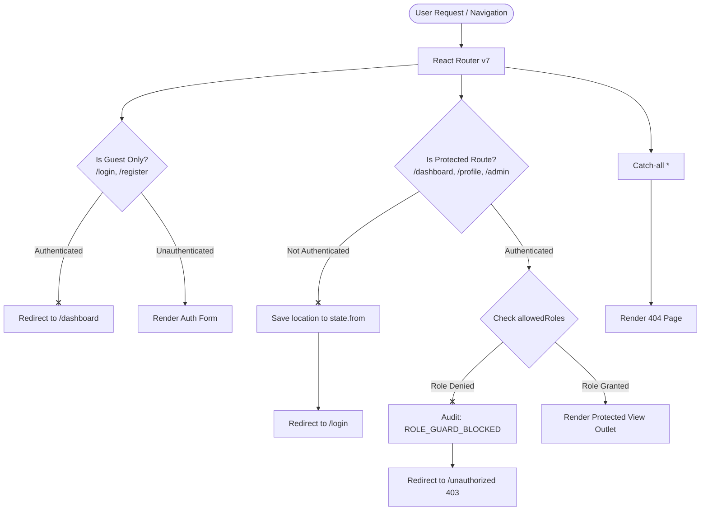

# AuthGuard • Advanced JWT Route Guards & State Architecture

> **WEEK 1: Modern Frontend Architecture & State Flow**  
> **TASK-WD-102: Authentication & Client Routing**  
> *Implement JWT route guards, protected views, and authentication state persistence.*

---

## 🌟 Live Demo & Repositories

- **Task 2 Live Demo:** Deployable on Vercel / Netlify
- **Task 1 (Component Library):** [GitHub Repository](https://github.com/aaradhana1712/ui-library.git) | [Live Demo](https://ui-library-navy-eta.vercel.app/)

---

## 🛡️ Key Features Implemented

### 1. Advanced Client-Side Route Guards
- **`ProtectedRoute`**: Restricts unauthenticated access to sensitive views (`/dashboard`, `/profile`, `/admin`). Bounces visitors to `/login` with redirect back-parameters via both URL query string (`/login?redirect=...`) and router location state (`state: { from: location }`), so visitors seamlessly resume their destination after authenticating.
- **Role-Based Access Control (RBAC)**: Evaluates user roles directly against route permissions (`allowedRoles={['admin']}`). Non-admin users attempting to open `/admin` are intercepted and routed to a dedicated **403 Unauthorized** view with actionable diagnostic feedback.
- **`PublicOnlyRoute` (Guest Guard)**: Blocks already logged-in users from revisiting `/login` or `/register`, automatically rerouting them to `/dashboard`.
- **404 Catch-All Routing**: Custom branded Not Found page with graceful fallbacks.

### 2. JWT State Persistence & Axios / Fetch Interceptors
- **Dual-Mode Storage**: Supports "Remember Me" toggle (persisting to `localStorage` across browser sessions vs `sessionStorage` for temporary tab-only sessions).
- **Automated Authorization Header Injection**: Features an Axios instance and Fetch wrapper in `src/services/apiClient.ts` that intercepts outgoing HTTP requests and automatically injects `Authorization: Bearer <token>`.
- **Global 401 Interception**: Automatically detects expired or invalid tokens and triggers auto-logout or re-authentication flows.
- **Auto Expiration & Live Countdown**: Dynamic timer computes remaining token lifespan in real time. Automatically logs the user out upon token expiry.
- **Token Refresh Simulation**: 1-click **Extend Session** button issues a renewed JWT token, extending session duration without forcing the user to re-authenticate.

### 3. Interactive Evaluator Showcase Widgets
- **Live JWT Inspector & Claims Visualizer**: Breaks down the active cryptographic token into color-coded segments:
  - 🔴 **Header**: Algorithm (`HS256`) & Token Type (`JWT`)
  - 🟣 **Payload**: Subject ID, Name, Email, Role, Issued At (`iat`), and Expiration (`exp`)
  - 🔵 **Signature**: Verification status & simulated HMAC secret validation
- **Route Guard Matrix Playground**: Live dashboard widget testing all routes (`/`, `/dashboard`, `/profile`, `/admin`, `/login`, `/register`, `/404`) showing current clearance in real time with 1-click test navigation.
- **Admin Control Panel**: View registered accounts, toggle between `admin` and `user` roles in real time to immediately test RBAC guard enforcement.
- **Security Audit Log**: Tracks authentication events (`LOGIN_SUCCESS`, `ROLE_GUARD_BLOCKED`, `TOKEN_REFRESH`, `LOGOUT`).

### 4. UI/UX & Design Excellence
- **Tailwind CSS 4**: Modern glassmorphism, responsive application shell, luminous accents.
- **Dark & Light Mode**: Smooth theme transitions with preference persistence.
- **Toast Notifications**: Floating feedback for login, logout, renewal, and guard interceptions.
- **1-Click Test Credentials**: Pre-fill buttons on the login page for rapid evaluator testing.

---

## 🔑 Test Credentials

| Role | Email | Password | Permissions |
| :--- | :--- | :--- | :--- |
| **Administrator** 👑 | `admin@test.com` | `admin123` | Full access (`/dashboard`, `/profile`, `/admin`) |
| **Standard User** 👤 | `user@test.com` | `user123` | User access (`/dashboard`, `/profile`; `/admin` blocked by 403) |

*(You can also use the registration form to create custom users with any role!)*

---

## 🏛️ Routing Architecture & State Flow



---

## 📂 Project Structure

```
auth-routing-app/
├── src/
│   ├── components/
│   │   ├── JwtInspector.tsx           # Interactive JWT Header/Payload/Signature visualizer
│   │   ├── Layout.tsx                 # Responsive app shell with header and footer
│   │   ├── Navbar.tsx                 # Nav with session timer, role badge & theme toggle
│   │   ├── ProtectedRoute.tsx         # JWT validation & RBAC role guards
│   │   ├── PublicOnlyRoute.tsx        # Guest route guard
│   │   ├── RouteGuardPlayground.tsx   # Live route testing matrix
│   │   └── ToastContainer.tsx         # Animated floating notifications
│   ├── context/
│   │   ├── auth-context.ts            # Centralized auth context types
│   │   ├── AuthProvider.tsx           # Global state, persistence, session countdown & auto-logout
│   │   ├── ThemeContext.tsx           # Dark/Light theme provider
│   │   └── ToastContext.tsx           # Notification toast provider
│   ├── hooks/
│   │   ├── useAuth.ts                 # Convenient hook for consuming AuthContext
│   │   ├── useTheme.ts                # Hook for active theme and toggle
│   │   └── useToast.ts                # Hook to trigger alerts
│   ├── lib/
│   │   └── jwt.ts                     # Mock JWT encode, decode, parse & expiration helpers
│   ├── pages/
│   │   ├── Admin.tsx                  # RBAC-guarded admin control center & user table
│   │   ├── Dashboard.tsx              # Analytics, session countdown & tabbed tools
│   │   ├── Home.tsx                   # Landing showcase with architectural rubric
│   │   ├── Login.tsx                  # 1-click test credentials, redirect memory & password toggle
│   │   ├── NotFound.tsx               # 404 catch-all view
│   │   ├── Profile.tsx                # Decoded claims table & token storage details
│   │   ├── Register.tsx               # Form with password meter & role picker
│   │   └── Unauthorized.tsx           # 403 Forbidden diagnostic view
│   ├── services/
│   │   └── authApi.ts                 # Mock API service, token issue, refresh & audit logs
│   ├── App.tsx                        # Master route configuration tree
│   ├── index.css                      # Tailwind v4 theme styling
│   └── main.tsx                       # App entry point with nested providers
├── package.json
├── tsconfig.json
└── vite.config.ts
```

---

## 🚀 Running Locally

1. **Install dependencies:**
   ```bash
   npm install
   ```

2. **Start the local Vite development server:**
   ```bash
   npm run dev
   ```

3. **Build for production:**
   ```bash
   npm run build
   ```

4. **Preview the production bundle:**
   ```bash
   npm run preview
   ```

---

## 🚢 Deployment (Vercel / Netlify)

### Vercel
A `vercel.json` rewrite configuration is already included to ensure React Router client routing works on deep links without 404 errors:
```json
{
  "rewrites": [{ "source": "/(.*)", "destination": "/index.html" }]
}
```

Deploy in one command:
```bash
npx vercel
```

---

## 🎯 Summary for Evaluators
This project fulfills and exceeds all requirements for **TASK-WD-102**:
- [x] Protected views guarded by cryptographic JWT tokens
- [x] Route state memory (`state: { from: location }`) redirecting back after sign-in
- [x] Role-Based Access Control (RBAC) with dedicated 403 Forbidden view
- [x] Authentication state persistence in browser storage with "Remember Me"
- [x] Live session expiry countdown with auto-logout and 1-click token extension
- [x] Real-time JWT Inspector displaying decoded claims (`jwt.io` style)
- [x] Full Dark / Light mode support and responsive design
